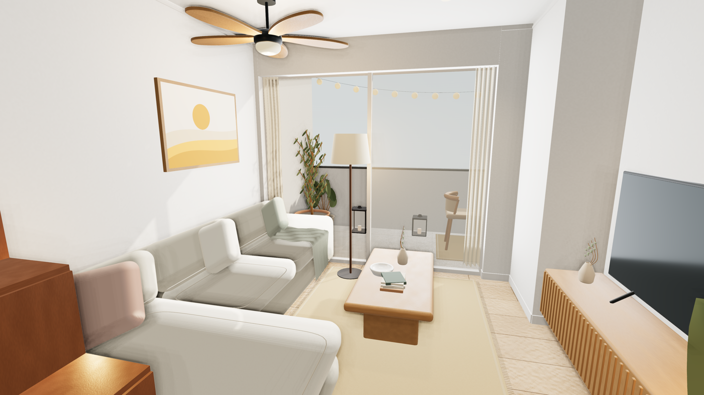
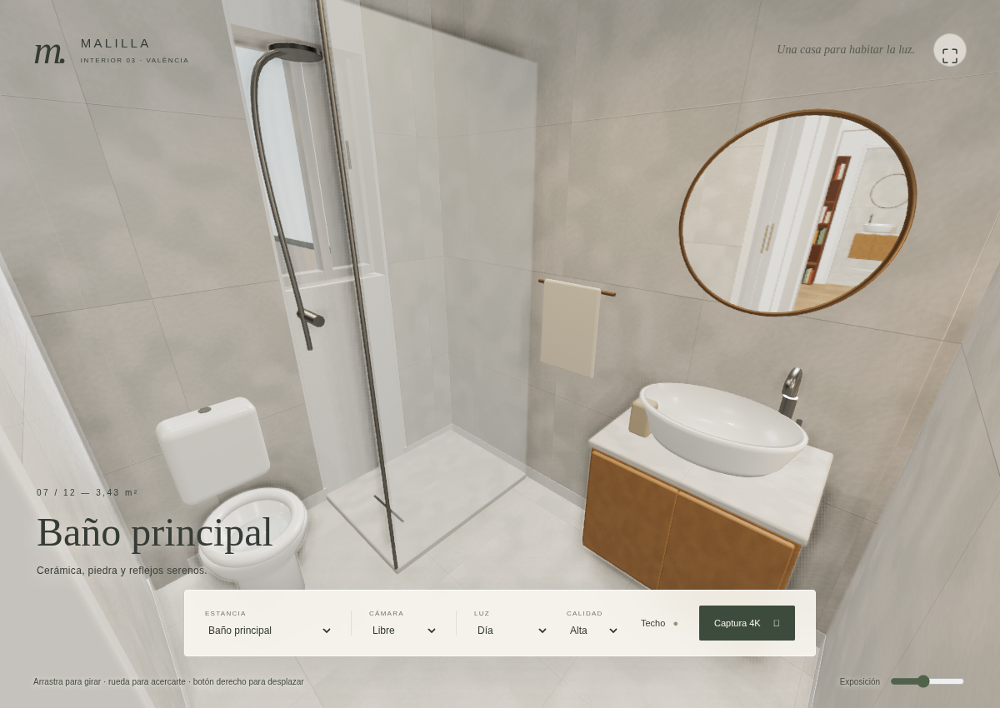
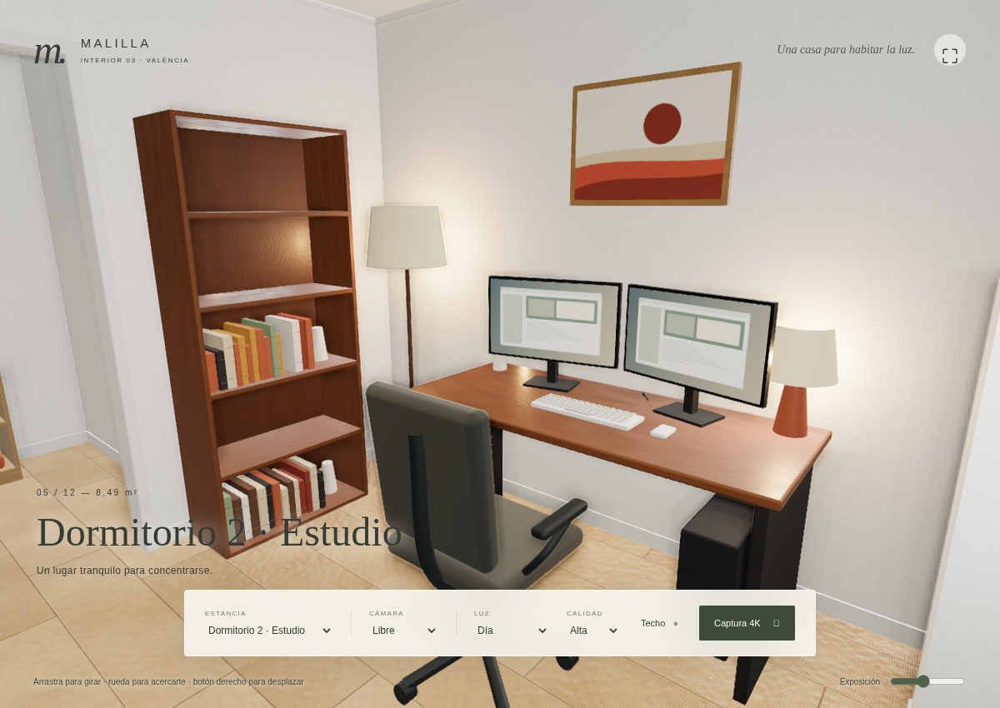
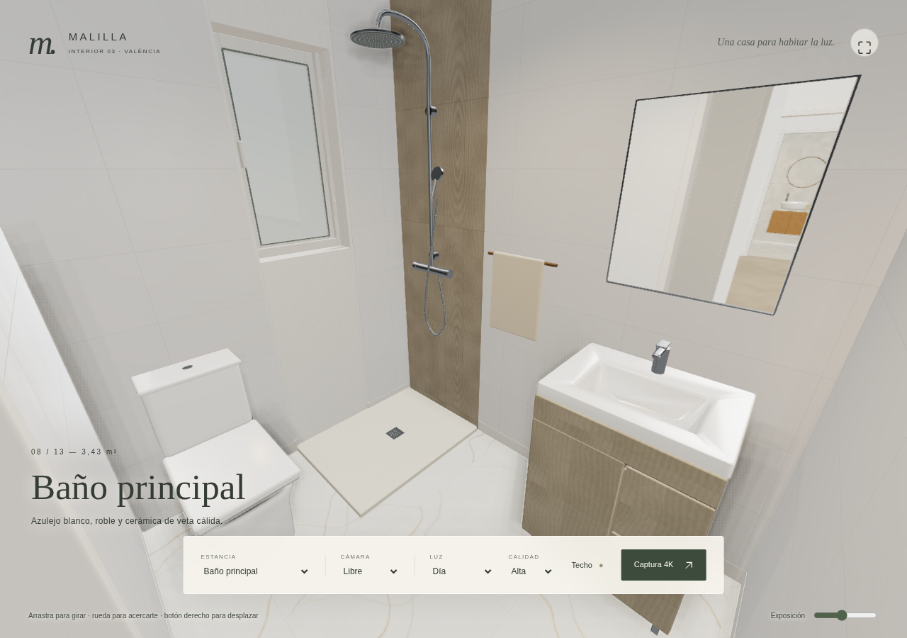
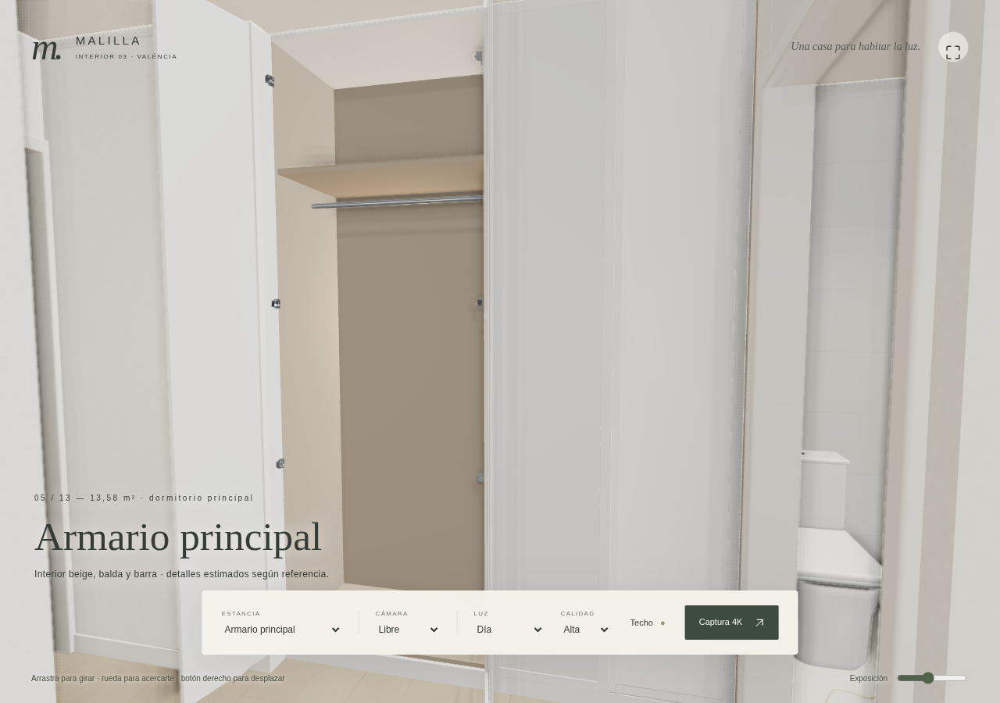
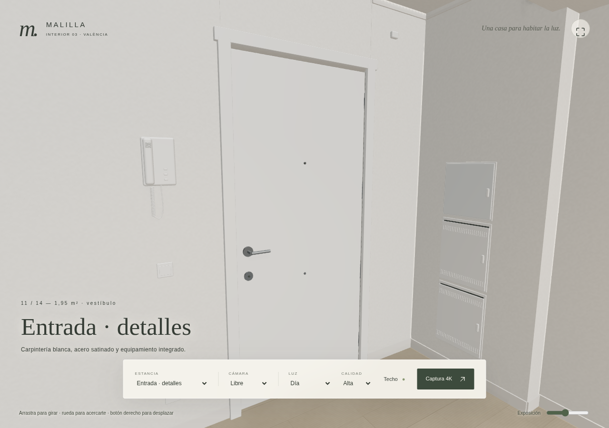
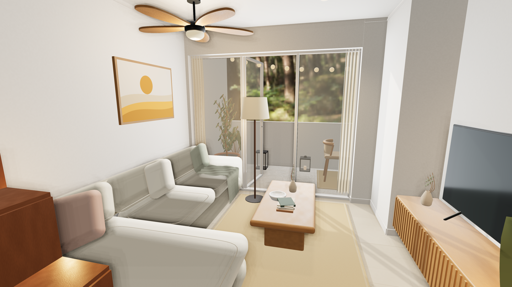

# Control de calidad y limitaciones

## Evidencia ejecutada

- Node 24.22.1, Python 3.12.14 para generar texturas, Chromium instalado en el entorno.
- `npm run build`: correcto. Vite avisa de un bundle JS de ~974 kB (320 kB gzip). La advertencia no se ha ocultado. Texturas locales: ~16 MB.
- `npm test`: **6 pruebas, 6 correctas**. Paridad numérica contra el bloque del HTML original (incluido mobiliario A), propuestas B/C, discrepancia de áreas, círculo de colisión y forma L de chaise, existencia y dimensiones WebP reales de los 18 mapas.
- Original y adjunto: SHA256 idéntico `f8e31abb4ca76f5afa47148ca6d94ba6c3d7dc76e14395a769ee7b056afc8778`.
- `node scripts/visual-qa.mjs`: capturadas las **12 vistas** y Día/Atardecer/Noche; sin errores JS ni errores de shader registrados en esas vistas. La primera ejecución del bloque de interacción falló por un objeto incompleto en el script de comprobación (`floor()`); se corrigió el script y se completó esa validación por separado. No fue un fallo del modelo.
- `npm run test:interaction`: correcto. Fuera de vivienda y muro bloqueados; hueco de dormitorio 3 y suelo libre transitables. Movimiento de (8,45; 4,65) a (8,718; 5,773), altura constante 1,62 m. Sombra Ultra verificada en 4096²; selección de perfil, techo y controles móviles comprobados.
- PNG exportado por el botón Captura 4K: **3840 × 2160**, RGBA, ~9,3 MB. Dimensiones leídas del encabezado PNG y corroboradas con Pillow; varianza RGB no nula y miniatura de inspección revisada. El PNG no incluye la interfaz. No es un canvas pequeño ampliado por CSS.
- SSAO activado frente a desactivado, mismo salón y cámara: diferencia absoluta RGB media 2,39/255 y 180.385 píxeles con diferencia >3 canales. Inspeccionada la imagen de contacto de sofá/mesa/suelo. La métrica confirma que el efecto cambia la imagen, no que sustituya GI.
- Vista móvil 390 × 844 inspeccionada; posteriormente se separó más la leyenda del panel y se sustituyó el glifo de exportación por SVG.

Las capturas completas y el PNG 4K están en `artifacts/` (ignorado). `docs/qa-results.json` conserva resultados. Las imágenes siguientes son capturas del visor, **no imágenes generadas externamente**. La del salón es una miniatura del PNG 4K; la miniatura no se presenta como archivo 4K.

## Correcciones tras inspección

Cámara inicial alejada de la vegetación; drapeado de manta corregido; lámparas duplicadas de mesillas retiradas; palas del ventilador rediseñadas; teclado, monitores, silla y lomos de libros mejorados; revestimientos y encuadre del baño ajustados; exposición nocturna indirecta reequilibrada para evitar asientos casi negros. Reflejos de espejos limitados a proximidad (3,5 m), mallas agrupadas, sombras retenidas mientras la escena sea estática y renderizado bajo demanda.

## Valoración honesta

Esta entrega es una visualización interactiva amueblada y mejorada, con detalle procedural, **no una validación de calidad fotográfica ArchViz profesional**. Los mapas originales 2K y las primitivas trabajadas no equivalen a modelos artísticos escaneados ni tejidos simulados offline. Algunas piezas secundarias siguen mostrando su origen paramétrico. No se han marcado las diez fases como terminadas con calidad profesional.

- **Iluminación:** no hay GI horneada ni trazado de caminos. Luces rectangulares de ventana y lámparas sin sombra pueden introducir luz indirecta imprecisa o filtraciones. Las sombras solares PCF y los focos con sombra no producen penumbra físicamente trazada. SSAO depende de la pantalla y puede producir halos.
- **Textiles/vegetación:** pliegues y hojas son procedurales; el detalle cercano aún necesita modelado artístico y mejor unwrap. Sin física de tejidos, microfibras geométricas ni SSS vegetal.
- **Vidrio:** transparencia y reflejo aproximados, sin refracción óptica completa. Espejos planares reales, limitados en distancia y resolución. No hay reflejos exactos de toda la escena en cada material.
- **Fidelidad:** coordenadas y distribución fuente conservadas, pero alturas y detalles añadidos son estimaciones. Los encuentros y posibles errores del plano original no se reinterpretan como un levantamiento certificado. Los huecos no tienen puertas interactivas: las correderas están retraídas y las batientes interiores abiertas.
- **Rendimiento:** Chromium usa ANGLE/SwiftShader por software. El coste inicial de shaders y las capturas tarda segundos o minutos. No hay benchmark de FPS de una GPU física ni validación de navegadores móviles reales. Los contadores de draw/triángulos incluyen pases auxiliares, sombras y reflejos; no son triángulos únicos. El tiempo CPU de envío no mide el tiempo GPU.
- **Capturas:** 4K real probado en este entorno; no se garantiza en todo móvil. No hay mosaicos ni exportación superior a 4K validada.
- **Editor:** se conserva separado en `legacy/`; no se integró edición de muebles en el visor nuevo. Solo se visualiza A aunque B/C siguen en los datos originales.

## Mejoras prioritarias

1. Sustituir piezas secundarias y textiles hero por modelos GLB elaborados con envolventes ajustadas al plano y licencias verificadas; mantener el contrato de dimensiones.
2. Hornear iluminación indirecta y AO por estancia con Blender sobre esta geometría, preparar UV2 y revisar cada unión de luz.
3. Incorporar madera, piedra y tejidos fotografiados con procedencia y escala física verificadas; unwrap manual por objeto.
4. Sustituir vegetación por modelos botánicos de mayor calidad y calibrar vidrio/reflejos.
5. Perfilar en GPU real, ajustar agrupación espacial y niveles de detalle sin degradar el modo Ultra; después estudiar mosaicos con margen de solapamiento de postprocesado.

## Revisión con las referencias fotográficas

Continuación posterior a la entrega inicial; no sustituye las limitaciones de GI, materiales procedurales o rendimiento de GPU indicadas arriba.

- **8/8 pruebas**: se añaden correspondencia de IDs fijos/cotas estimadas y comprobación de los tamaños reales de los 15 mapas nuevos. El original sigue con el mismo SHA256 y las coordenadas fuente pasan la prueba de paridad.
- Compilación de producción y formato correctos. El aviso de tamaño del bundle permanece (~983 kB, 324 kB gzip); mapas locales ~18 MB.
- `CAPTURE_4K=1 node scripts/reference-qa.mjs`: correcto. Inspeccionadas cinco vistas actualizadas (baño principal, armario, dormitorio principal, baño 2 y salón), además del baño principal de noche. Sin errores JS/shader registrados.
- Comprobación geométrica del lavabo mediante rayo vertical: impacto en la cerámica `fffefa` a Y=0,7336 m, en vez de la carcasa beige a Y=0,805 m que invadía inicialmente la cubeta. Carcasa ahora hueca y fondo cerámico continuo.
- Dos hojas abiertas del armario con polígonos adicionales; ambos centros bloquean el paseo. Las correderas, los huecos y las envolventes fijas originales no se han desplazado.
- Nueva captura descargada: `artifacts/references/Malilla-bathroom-3840x2160.png`, **3840 × 2160 reales**, 4.475.712 bytes. Encabezado PNG y dimensiones Pillow comprobados; imagen no vacía y miniatura inspeccionada. No incluye UI ni píxeles de las fotografías.
- Resultado estructurado en `reference-qa-results.json`. La prueba inicial que leía un módulo de colisiones separado por la caché de Vite se corrigió para consultar una copia de los polígonos usados por la propia navegación.
- El visor ofrece ahora 13 cámaras, incluida «Armario principal»; la suite general recorre la lista de cámaras automáticamente. En esta revisión se ejecutó la suite visual dirigida, no otra pasada integral de todas las estancias.

## Revisión de entrada, salón y carpintería de terraza

- **11/11 pruebas** correctas. Se añaden paridad de huecos de entrada/terraza, apertura central transitable y checksum/dimensiones reales del panorama HDR local. Las 43 paredes y coordenadas del archivo original siguen sin modificarse.
- Build de producción correcto (~996 kB JS, 329 kB gzip; se conserva el aviso de tamaño). Verificación de formato y diff correctas.
- Revisadas seis cámaras: detalles de entrada, vestíbulo mirando hacia el salón, salón, comedor, terraza y baño principal. Capturas adicionales del salón al atardecer y entrada de noche. Sin errores JS/shader registrados.
- Colisiones del modelo inicializado: puerta de entrada cerrada bloqueada; paño fijo bloqueado; paso central de terraza libre. La hoja abierta queda dentro de la envolvente de la terraza. Estos controles verifican las colisiones usadas por el paseo, además de los polígonos puros de la prueba unitaria.
- Fondo HDR cargado realmente como DataTexture y revisado en la imagen. Es una imagen ambiental genérica de vegetación, no una vista real del inmueble y no una simulación de GI del interior. Las diferencias de luz se obtienen ajustando también sol y relleno; no se atribuyen al fondo por sí solo.
- Nuevo PNG del salón: **3840 × 2160**, 10.027.808 bytes. Encabezado, dimensiones y varianza de imagen comprobados; miniatura inspeccionada. Está en `artifacts/entry/Malilla-living-3840x2160.png`. La imagen siguiente es una miniatura, no el archivo 4K.
- Se detectó una captura inicial que mostraba la pantalla de carga. La revisión se repitió esperando a que desaparezca la capa y a que se renderice un nuevo fotograma de cada cámara. La pantalla de carga no se conserva como evidencia del modelo.
- Datos finales en `entry-qa-results.json`. El visor tiene 14 cámaras; esta revisión ejecuta una selección dirigida, no un benchmark de GPU ni una repetición de toda la suite original.

